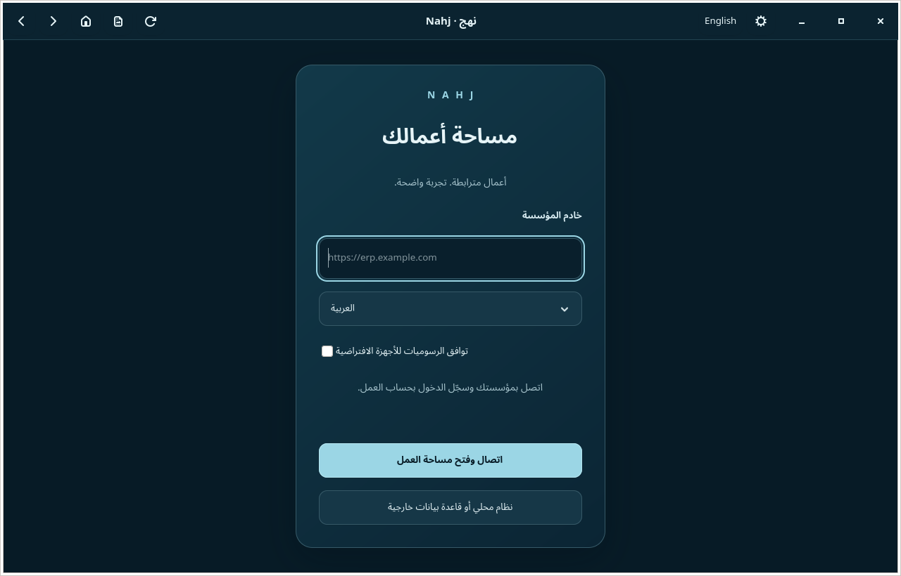

# نهج لإدارة الأعمال — Nahj ERP

تطبيق ديسكتوب عربي على Linux مبني على **ERPNext 16.53.0 وFrappe 16.54.0**. يجمع المحاسبة والمبيعات والمشتريات والمخزون والتصنيع وبقية وحدات ERPNext، مع العربية والإنجليزية وزر تبديل اللغة. يستخدم النظام الأصلي وقاعدة بيانات فعلية، ويمكن تشغيله محليًا أو الاتصال بخادم المؤسسة عبر HTTPS.

[دليل التثبيت](desktop/README.md) · [الخادم والنسخ والاستعادة](desktop/SERVER.md) · [اختبارات الإصدار](desktop/VERIFICATION-0.3.2.md) · [الاختبارات الموسّعة للوحدات](desktop/MODULE-TESTS.md) · [مراجعة المصدر](desktop/UPSTREAM-AUDIT.md) · [الصور](desktop/screenshots/0.3.1/README.md)

## حالة الإصدار

الإصدار **0.3.2-rc1** مرشح مختبر، مع Payments الرسمية داخل صورة الخادم و150 رسالة عربية إضافية. **[الإصدار وحزمة Arch وصورة الخادم](https://github.com/9a6r/erp-nahj/releases/tag/desktop-v0.3.2-rc1)** مرفقة بملف `SHA256SUMS` وتقرير التحقق. يحتفظ الإصدار السابق 0.3.1 بوسمه وملفاته الأصلية. نُشر الإصدار الجديد في 13 نوفمبر 2026، ونجح [اختبار التنزيل العام واستكماله](https://github.com/9a6r/erp-nahj/actions/runs/43448838609).

نجحت اختبارات التثبيت والواجهة على Arch/Linux Zen، والتشغيل الفعلي والنسخ والاستعادة، ونقل نسخة 0.3.1 إلى موقع مستقل مع بقاء الأصل صالحًا بعد إعادة التشغيل. لا توجد ترقية تلقائية لقاعدة العمل، ولا يُدعم خفض ERPNext 17 إلى 16. راجع [نتائج التحقق وحدودها](desktop/VERIFICATION-0.3.2.md).

اختبارات ERPNext الأصلية بتاريخ 13 نوفمبر: **5,760 نجاحًا من 5,762 اختبارًا** عبر 522 ملفًا، دون تخطٍّ. بقي اختبارا ميزانية أصليان فاشلين بسبب بيانات تعتمد على الشهر، مع نجاح 48 حالة مستقلة لحدود الميزانية عبر الشهور الـ12. الصورة المختبرة تحتوي Payments نفسها؛ لا يشمل ذلك خصمًا حيًا لدى مزود دفع. [النتائج التفصيلية](desktop/test-results/2026-11-13/README.md).

هذه النتائج لا تعني اعتماد كل إعدادات الشركات أو مزودي الخدمات الخارجية أو أجهزة الرسوميات. ابدأ بنسخة مستقلة من بيانات مؤسستك وتحقق من الأرصدة والصلاحيات والاستعادة قبل اعتمادها.

## التثبيت على Arch Linux

شغّل الأوامر بحسابك العادي على نظام Arch مثبت على القرص:

```bash
sudo pacman -S --needed git
git clone --depth 1 --branch desktop-v0.3.2-rc1 https://github.com/9a6r/erp-nahj.git
cd erp-nahj
./desktop/install.sh --with-server
nahj-desktop
```

يُثبّت المعالج الاعتماديات، ويبني حزمة `nahj-desktop` عبر pacman، ويُعدّ Podman دون root مع الحفاظ على نطاقات المستخدم الموجودة. يظهر «نهج» في قائمة التطبيقات. احذف `--with-server` إذا كنت ستتصل بخادم مؤسسة موجود فقط. إذا كانت مرايا Arch قديمة، أكمل `sudo pacman -Syu` ثم أعد المحاولة؛ لا تستخدم `pacman -Sy` وحده.

من الإعدادات اختر **نظام محلي أو قاعدة بيانات خارجية** لإنشاء موقع، أو أدخل رابط خادم المؤسسة. ينزّل معالج الإعداد المحلي صورة الخادم تلقائيًا ويتحقق من بصمتها؛ يمكنك أيضًا اختيار الأرشيف المنشور يدويًا. حجمه نحو 1.09 جيجابايت، وتحتاج الخدمات والبيانات والنسخ إلى مساحة إضافية. الخادم المحلي مخصص لـx86_64. أول إعداد يحتاج الإنترنت، ولا ينشئ معاملات أو شركة تجريبية في موقعك.

## الواجهة والطباعة



[الإنجليزية](desktop/screenshots/0.3.1/connection-en.png) · [إدارة الاستعادة](desktop/screenshots/0.3.1/recovery-controls-ar.png) · [فاتورة عربية فعلية من موقع الاختبار](desktop/screenshots/0.3.1/invoice-ar-completed.png) · [ملف PDF](desktop/screenshots/0.3.1/invoice-ar-completed.pdf)

هذه لقطات تشغيل فعلية؛ يوضح [دليل الصور](desktop/screenshots/0.3.1/README.md) بيئة كل مجموعة. صور إعدادات 0.3.1 مأخوذة على Debian، بينما اختبارات التوافق الحالية منفذة داخل Arch/Zen.

## ما الذي يحافظ عليه نهج؟

| المكوّن | الحالة |
| --- | --- |
| وحدات ERPNext الأصلية | 21 وحدة محفوظة |
| ملفات التطبيق الأصلية | 5360 محفوظة، منها 5356 بدون تغيير |
| تعريفات المستندات والتقارير | 531 تعريف مستند و186 تقريرًا بدون تغيير |
| التغييرات داخل تطبيق ERPNext | 4 ملفات مراجعة وملفان إضافيان؛ لا حذف لملفات الأصل |
| الترجمة | 19042 رسالة ERPNext/Frappe و150 رسالة Payments في الكتالوجات، مع استكمال عناصر واجهة البنوك |
| الديسكتوب | Python، GTK4، WebKitGTK6، حفظ الجلسة، تنزيل الملفات وتبديل اللغة |
| الخادم | Frappe، MariaDB، Redis، عامل المهام والجدولة في خدمات Podman منفصلة |

المقارنة مع الإصدار المستقر 16.53.0 المحدد في [مرجع البناء](desktop/server-image/upstream.json)، وليست ادعاءً بمطابقة فرع التطوير 17. الكتالوجات المكتملة لا تعني مراجعة بصرية ولغوية لكل شاشة. بيانات المستخدم وأسماء المنتجات لا تُترجم قسرًا. التطبيقات المنفصلة مثل HRMS تُضاف بإصدارات متوافقة عند الحاجة.

## ما الذي اختُبر؟

- المثبّت الفعلي على حساب Arch جديد، و46 اختبارًا للتطبيق، وGTK/WebKit على X11 وWayland، وحفظ الملفات وتبديل العربية والإنجليزية.
- تثبيت حزمة pacman وإعادة تثبيتها وإزالتها مع بقاء إعدادات المستخدم، وبقاء بيانات Podman بعد إعادة التشغيل.
- فواتير بيع وشراء وسداد، قيود متوازنة، مخزون، صلاحيات، مرفقات عامة وخاصة، وطباعة PDF عربية فعلية.
- نسخ قاعدة البيانات والملفات ومفاتيح التشفير، والاستعادة إلى موقع مستقل، ومراجعتها قبل تفعيل المهام والبريد، ثم فحص الموقعين بعد إعادة تشغيل Zen.
- إرسال بريد عربي وWebhook موقّع إلى مستقبِلات اختبار معزولة. يلزم اختبار حسابات مزودي الخدمات الفعلية الخاصة بمؤسستك.

[اختبارات الحزمة النهائية](https://github.com/9a6r/erp-nahj/actions/runs/43401088645) · [اختبارات التشغيل والاستعادة للمرشح المعرّب](https://github.com/9a6r/erp-nahj/actions/runs/43443753874) · [نتائج الوحدات الأصلية](desktop/test-results/2026-11-13/README.md).

## التشغيل والتطوير

| الدليل | المحتوى |
| --- | --- |
| [دليل المستخدم](desktop/README.md) | التثبيت، الاختصارات، التحديث والإزالة |
| [إدارة الخادم](desktop/SERVER.md) | الموقع المحلي، MariaDB الخارجية عبر TLS، النسخ والاستعادة والتكاملات |
| [مراجعة المصدر](desktop/UPSTREAM-AUDIT.md) | ما تغيّر وما بقي من الأصل وحدود التحقق |
| [التحقق](desktop/VERIFICATION-0.3.2.md) | إصدارات البيئة، بصمات الصور ونتائج الاختبارات |
| [التطوير](desktop/DEVELOPMENT.md) | الاختبارات والبناء والتغليف |
| [تغييرات نهج](desktop/CHANGELOG.md) | الإصلاحات والإضافات الخاصة بالتطبيق |

المصدر الأصلي في `erpnext/`، واجهة البنوك في `banking/`، والديسكتوب وإدارة الخادم في `desktop/`. تُضبط خدمات البريد وواجهات API وOAuth وWebhooks من إعدادات التكاملات الأصلية وفق الصلاحيات. الخدمات التي تحتاج إضافة منفصلة تتطلب تثبيت إضافتها المتوافقة وإعدادها؛ إدخال مفتاح API وحده لا ينشئ تكاملًا غير موجود.

## الأصل والترخيص

نهج مبني على [ERPNext](https://github.com/frappe/erpnext) و[Frappe](https://github.com/frappe/frappe). محفوظ تحت [GPL-3.0](license.txt) مع إشعارات وترخيص مكونات Frappe. [README الأصلي لـERPNext](README.erpnext.md) و[توثيقه](https://docs.frappe.io/erpnext) متاحان للرجوع إلى تفاصيل النظام الأصلي.
