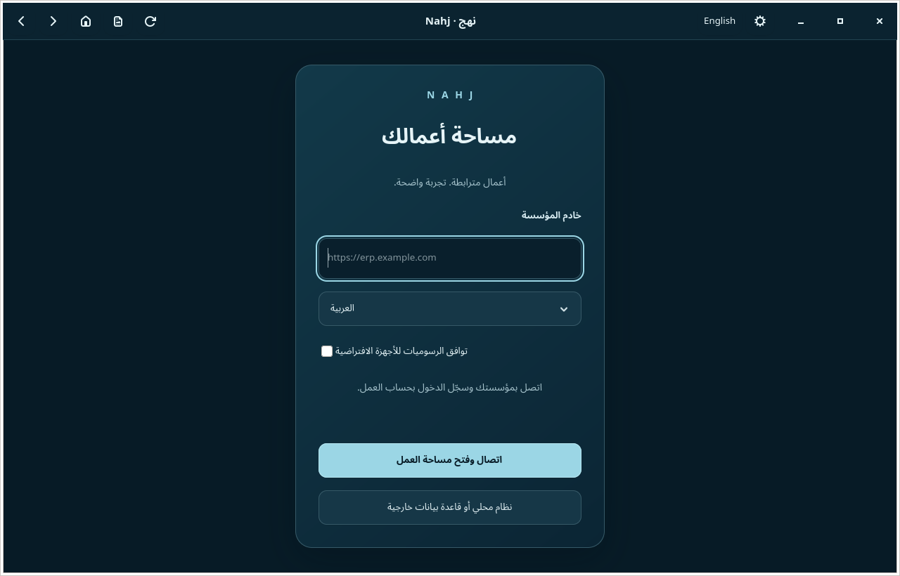
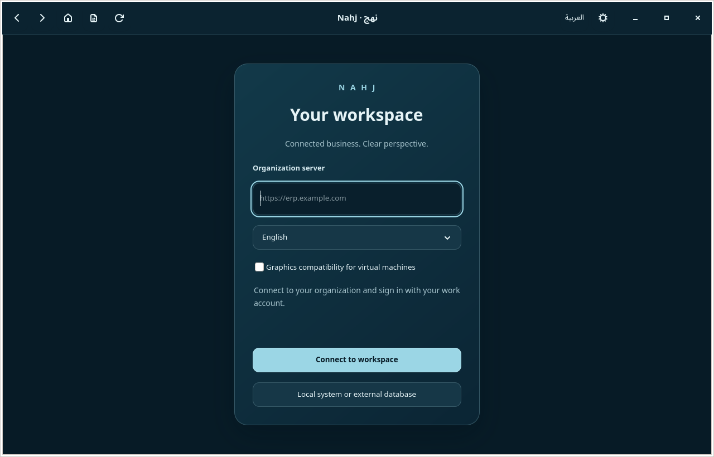
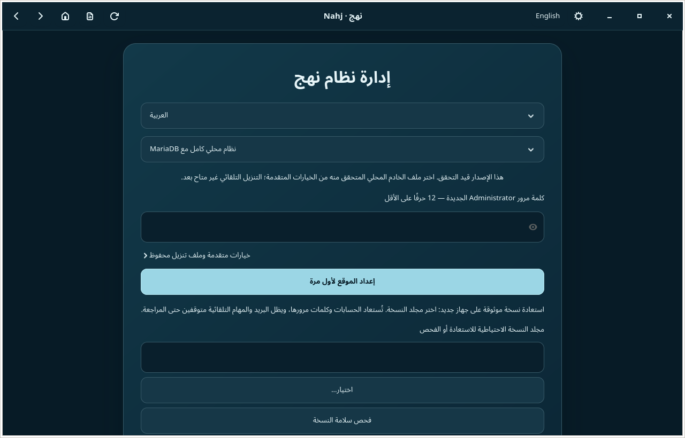
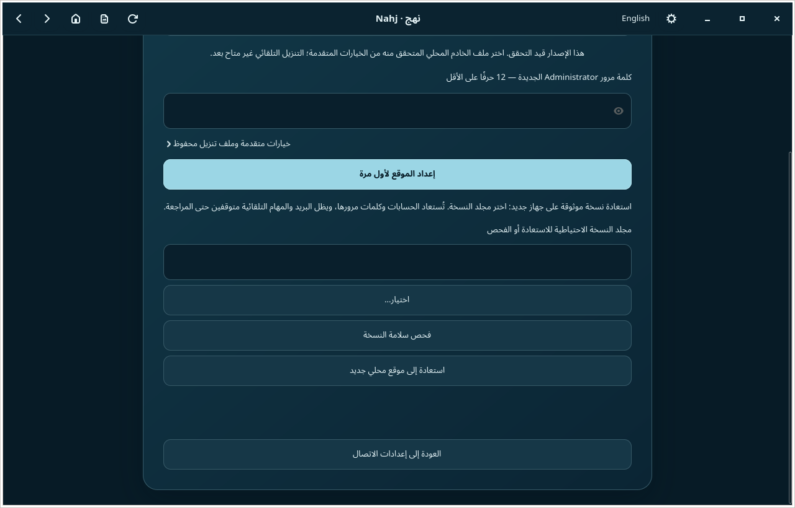
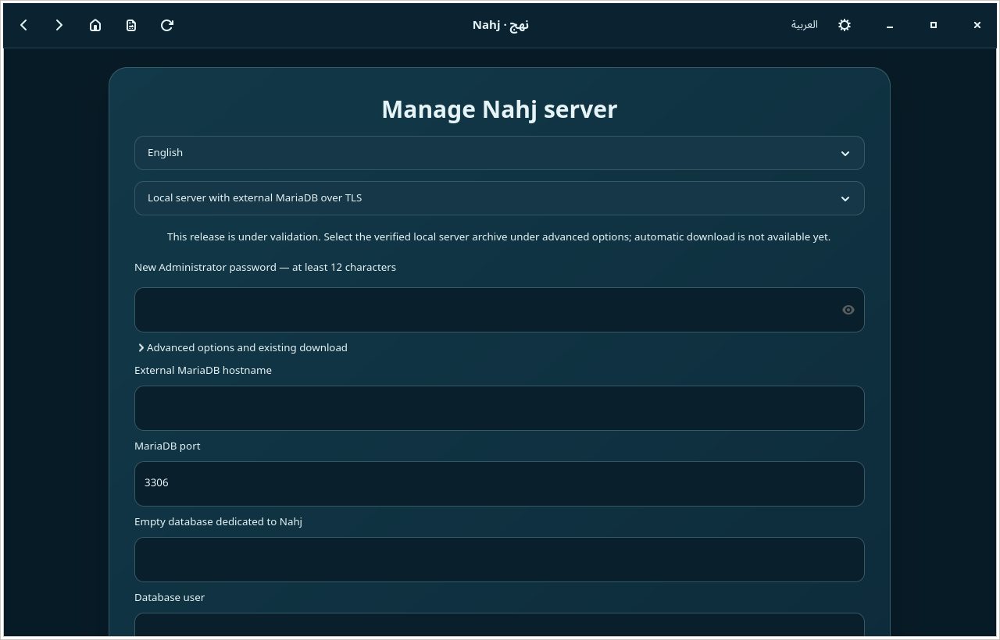
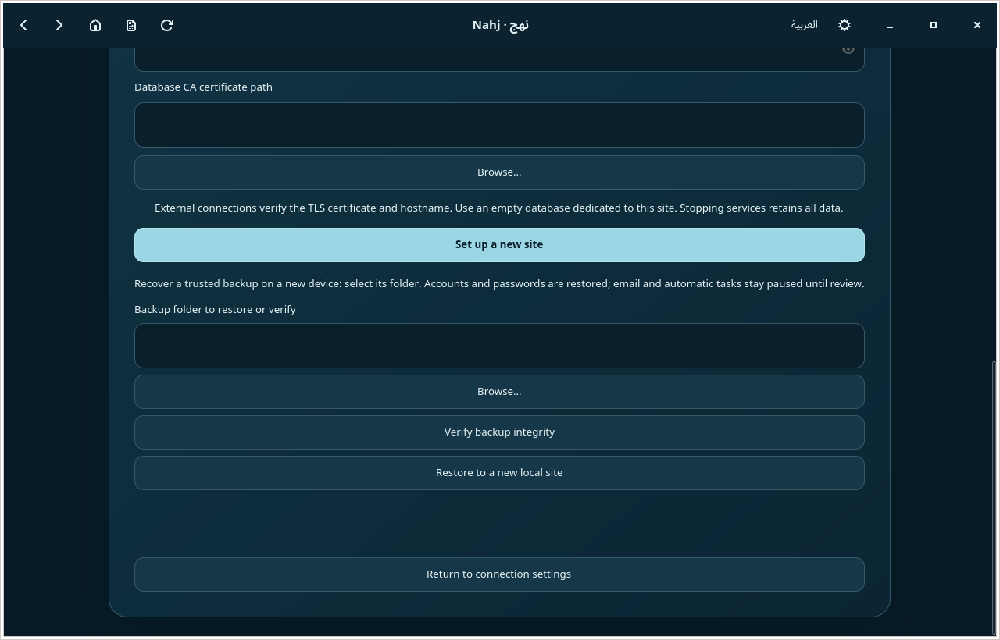
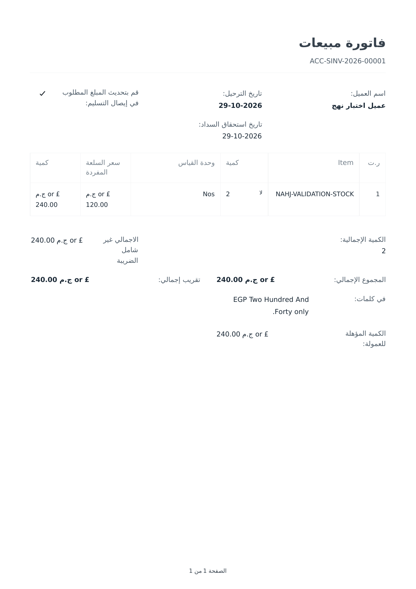
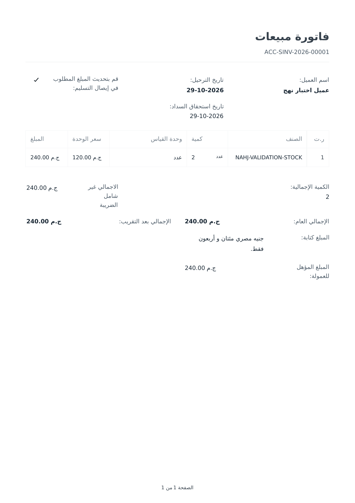

# صور نهج — النسخة الحالية

لقطات فعلية من التطبيق، التُقطت في ٥ نوفمبر ٢٠٢٦ بتوقيت القاهرة. اضغط الصورة لفتحها بالحجم الكامل.

## الاتصال بالعربية وزر تبديل اللغة

## الاتصال بالإنجليزية

## إعداد موقع محلي واستعادة نسخة احتياطية

الجزء السفلي من النافذة بعد التمرير، وفيه فحص النسخة واستعادتها إلى موقع جديد:

## قاعدة بيانات خارجية

## فاتورة صادرة من الموقع المستعاد

هذه صورة من PDF أُنتج لفاتورة بيع حقيقية داخل شركة اختبار، بعد استعادة القاعدة والمرفقات. البيانات تجريبية. الصورة الأولى تحفظ نتيجة الاختبار السابقة قبل إكمال ملفات الترجمة:

وبعد دمج الترجمة وتصحيح المبلغ ووحدات القياس ورمز الجنيه والتفقيط، أُعيد توليد الفاتورة نفسها من الخادم. لم تُعدَّل الصورة يدويًا ولم تُغيَّر المعاملة المحاسبية:

[تنزيل PDF الفعلي بعد التعريب](invoice-ar-completed.pdf)

النصوص والبيانات التي يُدخلها المستخدم وأكواد الأصناف تحتفظ بقيمها الأصلية. هذه الفاتورة دليل على مسار الطباعة المختبر، وليست شهادة بمراجعة كل تقارير النظام بصريًا.

لقطات النوافذ مأخوذة من GTK 4.18 على X11 في بيئة Debian، وليست دليلًا على اكتمال اختبار Arch/Zen أو جميع صفحات ERPNext. راجع [تقرير التحقق](../../VERIFICATION-0.3.1.md) لمعرفة نطاق الاختبارات والقيود.
